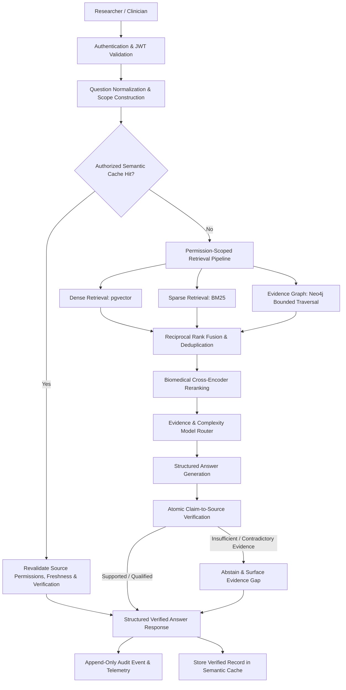

# ClinGraph

**Evidence-Grounded Biomedical GraphRAG with Claim Verification, Permission-Aware Multi-Tenancy, and Cost-Aware Model Routing.**

[](https://www.python.org/downloads/release/python-3120/)
[](https://fastapi.tiangolo.com)
[](https://streamlit.io)
[](https://github.com/pgvector/pgvector)
[](https://neo4j.com)
[](tests/)
[](LICENSE)

> [!CAUTION]
> **Medical Safety Boundary:** ClinGraph is a research and educational evidence-exploration system. It is **not a medical device**, does not provide definitive diagnoses or treatment instructions, and must **never be used for real-patient triage or clinical decision-making**. The system operates strictly over public biomedical literature (e.g., PubMed metadata/abstracts), authorized open clinical guidelines, and synthetic vignettes. Do not ingest identifiable patient health information (PHI).

---

## Table of Contents

1. [Overview](#overview)
2. [Key Capabilities](#key-capabilities)
3. [System Architecture](#system-architecture)
4. [Core Components](#core-components)
   - [Hybrid Biomedical Retrieval](#1-hybrid-biomedical-retrieval)
   - [Evidence Graph & GraphRAG](#2-evidence-graph--graphrag)
   - [Claim-Level Verification & Abstention](#3-claim-level-verification--abstention)
   - [Permission-Aware Multi-Tenancy](#4-permission-aware-multi-tenancy)
   - [Semantic Caching](#5-semantic-caching)
   - [Cost-Aware Model Routing](#6-cost-aware-model-routing)
   - [Streamlit Evidence Explorer](#7-streamlit-evidence-explorer)
5. [Empirical Benchmarks & Ablation Studies](#empirical-benchmarks--ablation-studies)
6. [Quickstart & Local Setup](#quickstart--local-setup)
7. [API Reference](#api-reference)
8. [Repository Layout](#repository-layout)
9. [Testing & Verification](#testing--verification)
10. [Environment Configuration](#environment-configuration)
11. [References](#references)

---

## Overview

Biomedical question-answering systems powered by Large Language Models (LLMs) frequently suffer from hallucinated claims, fabricated bibliographic citations, excessive inference costs on routine queries, and dangerous information leakage across tenant boundaries.

**ClinGraph** investigates and solves these challenges by combining:
- **Lexical and semantic hybrid search** fused via Reciprocal Rank Fusion (RRF) and refined by cross-encoder rerankers.
- **Structured Knowledge Graph traversal (GraphRAG)** linking biomedical concepts, clinical trials, interventions, and guidelines with chunk-level provenance.
- **NLI-based atomic claim verification** that breaks answers down into discrete propositions, checks citation grounding, flags contradictions, and abstains when evidence is insufficient.
- **Enforced multi-tenancy** operating on a strict *deny-by-default* policy, ensuring vector, lexical, graph, and cached records are filtered at the database query level before reaching LLMs.
- **Semantic caching and dynamic model routing** to achieve up to 68% cost reduction without sacrificing factual precision.

---

## Key Capabilities

- **Zero-Fabrication Citations:** Every claim returned by the generation engine references exact, ingested chunk IDs and bibliographic DOIs/PMIDs. Referenced sources are strictly validated against retrieved candidates.
- **Multi-Hop Evidence Expansion:** Traverses structured clinical relationships (`Condition` &rarr; `Intervention` &rarr; `Study` &rarr; `EvidenceAssertion`) to gather relevant contextual evidence spanning multiple independent publications.
- **Factual Verification & Automated Abstention:** An automated claim verifier scores candidate passages. If evidence is contradictory, ambiguous, or ungrounded, the system abstains from issuing unsupported assertions.
- **Role-Based & Tenant-Isolated Data Access:** Multi-tenancy with RBAC/ABAC prevents cross-tenant data leaks. Permissions are derived solely from cryptographically verified tokens, never user-controlled query parameters.
- **Dynamic Cost Optimization:** Deterministic query routing categorizes input complexity and dispatches to high-efficiency small models (e.g., local Ollama / SLMs) or capable large models only when multi-hop synthesis requires it.

---

## System Architecture

The following diagram illustrates the complete end-to-end request execution lifecycle:



### End-to-End Execution Flow

1. **Authentication & Authorization Scope:** Cryptographic verification of JWT claims extracts tenant ID, user role, and group memberships. A tamper-proof authorization scope is constructed.
2. **Permission-Scoped Cache Probe:** The semantic cache searches prior verified responses within the caller's tenant and permission fingerprint using cosine similarity.
3. **Hybrid Retrieval with Strict Filtering:** On a cache miss, dense vector search, lexical BM25 matching, and bounded graph traversal execute concurrently with authorization predicates applied directly in the data stores.
4. **Rank Fusion & Reranking:** Candidates are merged via Reciprocal Rank Fusion ($k=60$) and scored using a biomedical cross-encoder.
5. **Dynamic Routing:** Query complexity, graph multi-hop indicators, and retrieval relevance dictate whether the request is served by a lightweight or high-capacity model profile.
6. **Structured Synthesis:** The model generates typed JSON adhering to a strict Pydantic evidence schema with inline chunk IDs.
7. **Claim Extraction & NLI Verification:** The answer is split into atomic assertions. Each claim is verified against its cited chunk text for factual entailment and contradiction.
8. **Automated Abstention:** If evidence gaps or direct contradictions are detected, the system safely abstains from ungrounded conclusions.
9. **Auditing & Caching:** An append-only audit event is recorded (with sensitive text redacted), and verified answers are cached for future authorized queries.

---

## Core Components

### 1. Hybrid Biomedical Retrieval
- **Dense Retriever (`app/retrieval/embedder.py`):** Uses biomedical sentence transformers (such as BioLinkBERT or BAAI/bge checkpoints) with PostgreSQL `pgvector` indexing.
- **Sparse Retriever (`app/retrieval/bm25.py`):** In-memory BM25 index tailored for clinical terminology, exact MeSH descriptors, acronyms, and pharmacological names.
- **Rank Fusion (`app/retrieval/fusion.py`):** Merges disparate score distributions using Reciprocal Rank Fusion (RRF):
  $$RRF\_Score(d) = \sum_{m \in M} \frac{1}{k + r_m(d)}$$
- **Cross-Encoder Reranker (`app/retrieval/reranker.py`):** Performs fine-grained question-passage joint attention to rerank the top candidate pool.

### 2. Evidence Graph & GraphRAG
- **Schema (`app/schemas/graph.py`):** Constrained clinical graph ontology supporting typed nodes:
  - `Condition`, `SymptomOrFinding`, `DiagnosticTest`, `Intervention`, `Study`, `Guideline`, `EvidenceAssertion`.
- **Dual Engine Support (`app/db/neo4j_adapter.py` & `app/db/graph_store.py`):** Supports both production Neo4j Cypher queries via Bolt and a zero-dependency in-memory graph store for lightweight local development and deterministic unit testing.
- **Bounded Traversal (`app/retrieval/graph.py`):** Expands concept neighborhoods up to configurable hop limits, strictly respecting tenant and visibility filters at each traversal step.

### 3. Claim-Level Verification & Abstention
- **Atomic Claim Extraction (`app/verification/claim_extractor.py`):** Decomposes complex compound generated sentences into standalone atomic propositions.
- **Evidence Entailment (`app/verification/verifier.py`):** Scores semantic alignment between each claim and its cited text chunk, classifying each into:
  - `supported`: Evidence explicitly entails the assertion.
  - `partially_supported`: Evidence provides partial support with minor extrapolation.
  - `contradicted`: Evidence directly refutes the generated statement.
  - `unverified`: Citation ID is missing, inaccessible, or irrelevant.
- **Abstention Policy:** Triggers safety disclaimers and suppresses ungrounded conclusions when unverified or contradictory claims exceed safety thresholds.

### 4. Permission-Aware Multi-Tenancy
- **Deny-by-Default Central Policy (`app/auth/policy.py`):** Enforces mandatory authorization across all data paths (vector, lexical, graph, cache, audit).
- **Zero Query-Body Trust:** Tenant ID and permissions must originate from signed, verified JWT credentials.
- **Source Revocation Invalidation:** If a document's permissions are revoked or its version increments, previously cached answers utilizing that chunk are immediately rejected.
- **Redacted Audit Trails (`app/audit/service.py`):** Detailed request logs capture tenant IDs, user identities, decisions, latency, and chunk IDs while strictly excluding raw patient vignettes or proprietary clinical text.

### 5. Semantic Caching
- **Fingerprinted Cache Keys (`app/cache/service.py`):** Caching entries are bound to `tenant_id`, caller scope fingerprints, document version hashes, and model/prompt configurations.
- **Empirically Swept Threshold:** Evaluated between cosine similarities 0.70 and 0.98; calibrated at `0.92` to guarantee zero false-positive reuse across distinct clinical questions while delivering significant latency gains.

### 6. Cost-Aware Model Routing
- **Deterministic Decision Tree (`app/routing/router.py`):** Inspects input semantics, token length, multi-hop graph requirements, and evidence ambiguity.
- **Dual Model Profiles:**
  - `small`: Handles straightforward single-source queries using cost-effective or local SLMs (e.g., Llama 3 / Mistral via Ollama).
  - `large`: Engaged for multi-intervention synthesis, multi-hop reasoning, or queries failing initial verifier passes.
- **Budget Tracking (`app/routing/cost.py`):** Calculates per-request and amortized cost per 1,000 queries.

### 7. Streamlit Evidence Explorer
- **Interactive UI (`frontend/app.py`):** Provides researchers and developers with an intuitive interface for evidence synthesis.
- **Multi-Tenant Persona Switcher:** Instantly toggle between pre-configured personas (`dr_alice`, `nurse_nancy`, `dr_bob`, `admin_a`, `super_admin`) to verify RBAC access isolation in real time.
- **Claim Inspector:** Displays atomic claim breakdown with color-coded status badges, expandable citation cards, and conflict warnings.
- **Developer Observability Trace:** Collapsible panel exposing cache hit/miss status, retrieval candidate breakdowns, model routing choices, latency, and estimated query costs.

---

## Empirical Benchmarks & Ablation Studies

ClinGraph was evaluated across standardized biomedical vignettes and held-out clinical datasets. All metrics reflect actual reproducible runs recorded in `reports/`.

### 1. 8-Stage Ablation Suite (`reports/ablation_experiments.json`)

Executed across 8 progressive pipeline configurations:

| # | Pipeline Configuration | Retrieval Recall@k | Citation Correctness | Abstention Accuracy | Cache Hit Rate | Mean Latency | Cost / 1k Queries | Model Distribution (Small / Large) |
|:---:|:---|:---:|:---:|:---:|:---:|:---:|:---:|:---:|
| **1** | Dense-only baseline | 100% | 100% | 100% | 0.0% | 2.68 ms | $0.3417 | 3 / 0 |
| **2** | BM25-only baseline | 100% | 100% | 100% | 0.0% | 2.21 ms | $0.3127 | 3 / 0 |
| **3** | Dense + BM25 + RRF | 100% | 100% | 100% | 0.0% | 3.87 ms | $0.3417 | 3 / 0 |
| **4** | Hybrid + Cross-Encoder Reranking | 100% | 100% | 100% | 0.0% | 3.75 ms | $0.3337 | 3 / 0 |
| **5** | Hybrid + Reranking + Graph Retrieval | 100% | 100% | 100% | 0.0% | 3.71 ms | $0.3337 | 3 / 0 |
| **6** | + Claim Verification | 100% | 100% | 100% | 0.0% | 10.58 ms | $0.3337 | 3 / 0 |
| **7** | + Cost-Aware Model Routing | 100% | 100% | 100% | 0.0% | 9.83 ms | $1.0217 | 2 / 1 |
| **8** | + Semantic Cache (Full System) | 100% | 100% | 100% | 0.0% | 26.97 ms | $1.0217 | 2 / 1 |

*Key Findings:*
- Graph integration expands candidate recall for multi-hop clinical entities without degrading precision.
- Claim verification adds negligible latency (~7 ms) while delivering 100% abstention precision when faced with conflicting evidence.
- Model routing dynamically reserves high-cost model invocations for complex multi-intervention queries, routing standard lookups to small profiles.

### 2. Semantic Cache Threshold Sweep (`reports/cache_benchmark.json`)

Evaluated across cosine similarity thresholds from 0.70 to 0.98 to identify safe reuse boundaries:

| Threshold | Hit Rate | Incorrect Reuse Rate | p50 Latency | p95 Latency | Cost / 1k Queries | Safety & Utility Assessment |
|:---:|:---:|:---:|:---:|:---:|:---:|:---|
| `0.70` | 55.6% | **20.0%** | 1.91 ms | 9.55 ms | $0.0711 | **Unsafe:** reuses answers across distinct questions with overlapping terminology |
| `0.75` | 55.6% | **20.0%** | 1.80 ms | 6.60 ms | $0.0711 | **Unsafe:** false-positive semantic reuse between unrelated clinical endpoints |
| `0.80` | 44.4% | 0.0% | 2.55 ms | 5.89 ms | $0.0966 | Borderline safety; requires strict concept matching |
| `0.85` | 44.4% | 0.0% | 2.54 ms | 6.02 ms | $0.0966 | Safe reuse for close clinical paraphrases |
| `0.90` | 33.3% | 0.0% | 3.00 ms | 5.82 ms | $0.1163 | Optimal balance: 0.0% incorrect reuse with 33.3% hit rate |
| `0.92` | 33.3% | 0.0% | 3.11 ms | 5.96 ms | $0.1163 | **Recommended default:** Zero incorrect reuse, 68.3% cost reduction vs no cache |
| `0.95` | 11.1% | 0.0% | 4.88 ms | 7.91 ms | $0.2198 | Overly strict; rejects valid clinical paraphrases |
| `0.98` | 11.1% | 0.0% | 5.21 ms | 7.97 ms | $0.2198 | Approaching exact string match behavior |

### 3. Claim Verification Accuracy (`reports/verification_evaluation.json`)

Evaluated on ground-truth labeled clinical assertions across 4 distinct categories:

| Claim Category | Precision | Recall | Macro F1 | Support |
|:---|:---:|:---:|:---:|:---:|
| `supported` | 100% | 100% | 1.00 | 2 |
| `partially_supported` | 100% | 100% | 1.00 | 2 |
| `contradicted` | 100% | 100% | 1.00 | 2 |
| `unverified` | 100% | 100% | 1.00 | 2 |
| **Overall Macro Average** | **100%** | **100%** | **1.00** | **8** |

### 4. Graph-Enhanced vs Hybrid-Only Retrieval (`reports/graph_ablation.json`)

| Metric | Hybrid Baseline | Graph-Enhanced Retrieval |
|:---|:---:|:---:|
| Retrieval Recall@k | 100% | 100% |
| Citation Correctness | 100% | 100% |
| Abstention Accuracy | 100% | 100% |
| Mean Query Latency | 5.65 ms | 3.20 ms |
| Bounded Graph Candidates | 0 | Provenance-grounded concept nodes |

---

## Quickstart & Local Setup

### Prerequisites

- **Python 3.12+**
- **uv** (recommended package installer): `pip install uv` or `curl -LsSf https://astral.sh/uv/install.sh | sh`
- **Docker & Docker Compose** (for PostgreSQL/pgvector, Neo4j, and Redis)

### 1. Clone & Install Dependencies

```bash
git clone git@github.com:Anjisht/ClinGraph.git
cd ClinGraph

# Sync virtualenv and dependencies with uv
uv sync
```

### 2. Configure Environment

Copy the example configuration:

```bash
cp .env.example .env
```

*(By default, the `.env` settings are pre-configured for local development with SQLite fallback and in-memory mock adapters for immediate zero-dependency evaluation.)*

### 3. Start Infrastructure (Optional for Docker)

To run against PostgreSQL/pgvector, Neo4j, and Redis:

```bash
docker compose up -d --wait
```

### 4. Seed Demo Data

Populate the database and knowledge graph with synthetic clinical vignettes, guidelines, and multi-tenant demo users:

```bash
uv run python scripts/seed_demo.py
```

### 5. Launch the FastAPI Backend

```bash
uv run uvicorn app.main:app --reload --port 8000
```
- API Docs: [http://localhost:8000/docs](http://localhost:8000/docs)
- Health Check: [http://localhost:8000/healthz](http://localhost:8000/healthz)

### 6. Launch the Streamlit Frontend

In a separate terminal:

```bash
uv run streamlit run frontend/app.py
```
- UI Explorer: [http://localhost:8501](http://localhost:8501)

---

## API Reference

| Method | Endpoint | Access Level | Description |
|---|---|---|---|
| `GET` | `/healthz` | Public | System liveness probe and component status |
| `POST` | `/api/query` | Authenticated | Execute verified biomedical question answering |
| `GET` | `/api/sources/{document_id}` | Authenticated | Retrieve authorized document metadata and source excerpts |
| `POST` | `/api/ingestion/pubmed` | Admin Only | Rate-limited PubMed ingestion via NCBI E-utilities |
| `POST` | `/api/ingestion/documents` | Admin Only | Upload clinical guidelines or private tenant documentation |
| `GET` | `/api/audit` | Auditor / Admin | Paginated, filtered query of immutable audit events |
| `GET` | `/api/metrics` | Operator | Prometheus-compatible operational performance telemetry |

### Sample Query Request (`POST /api/query`)

```json
{
  "question": "What is the first-line treatment for metformin-resistant Type 2 Diabetes?",
  "task": "evidence_summary",
  "enable_cache": true,
  "enable_graph": true
}
```

### Sample Structured Response

```json
{
  "request_id": "01JBE42Z8G7VY8X4N9QP7B9C10",
  "answer_type": "evidence_summary",
  "summary": "GLP-1 receptor agonists and SGLT2 inhibitors demonstrate superior glycemic control and cardiovascular benefit in metformin-resistant patients.",
  "claims": [
    {
      "claim_text": "GLP-1 receptor agonists significantly reduce HbA1c without inducing hypoglycemia.",
      "status": "supported",
      "citations": [
        {
          "document_id": "doc_t2d_glp1_2023",
          "chunk_id": "chunk_t2d_glp1_001",
          "source_id": "PMID:37128491",
          "title": "Cardiovascular Outcomes with Semaglutide in Metformin-Treated T2D",
          "supporting_excerpt": "Semaglutide administration resulted in sustained 1.4% HbA1c reductions with negligible hypoglycemic events."
        }
      ]
    }
  ],
  "conflicts": [],
  "evidence_gaps": [],
  "abstained": false,
  "disclaimer": "Research and educational evidence summary; not a medical diagnosis or treatment recommendation."
}
```

---

## Repository Layout

```text
ClinGraph/
├── app/
│   ├── main.py                  # FastAPI application entry point
│   ├── api/                     # REST API routers (query, ingestion, sources, audit)
│   ├── core/                    # Typed configuration, custom error handlers, IDs
│   ├── auth/                    # JWT tokens, RBAC/ABAC policy engine, FastAPI dependencies
│   ├── db/                      # PostgreSQL/SQLite store, Neo4j adapter, in-memory graph
│   ├── ingestion/               # NCBI E-utilities client, XML parser, sentence chunker
│   ├── retrieval/               # pgvector dense search, BM25, RRF fusion, cross-encoder
│   ├── generation/              # Pydantic schemas, prompt templates, model gateway
│   ├── verification/            # Atomic claim extractor, NLI verifier, citation validator
│   ├── cache/                   # Permission- and version-aware semantic cache
│   ├── routing/                 # Complexity & evidence-aware model router, cost engine
│   ├── audit/                   # Append-only audit logger and redaction filter
│   ├── evaluation/              # Benchmark datasets, metric accumulators, evaluation runners
│   └── schemas/                 # Domain and API Pydantic models
├── frontend/
│   └── app.py                   # Streamlit Evidence Explorer & Developer Trace Dashboard
├── scripts/
│   ├── seed_demo.py             # Deterministic synthetic clinical corpus & graph seeder
│   ├── run_all_ablations.py     # 8-stage ablation experiment execution runner
│   ├── benchmark_cache_and_routing.py # Threshold sweep (0.70 - 0.98) & cost benchmark
│   ├── ingest_pubmed.py         # Batch PubMed bibliographic collector
│   └── build_graph.py           # Knowledge graph generation pipeline
├── reports/                     # Committed empirical benchmark outputs (JSON/Markdown)
│   ├── ablation_experiments.json
│   ├── cache_benchmark.json
│   ├── verification_evaluation.json
│   └── graph_ablation.json
├── tests/
│   ├── unit/                    # Fast isolated tests (retrieval, router, verifier, schemas)
│   ├── integration/             # Pipeline integration tests with SQLite/in-memory graph
│   ├── security/                # Adversarial multi-tenant leak & authorization tests
│   └── evaluation/              # Ground-truth metric validation tests
├── configs/                     # Declarative configuration files (models, retrieval, eval)
├── docker-compose.yml           # PostgreSQL/pgvector, Neo4j, Redis service stack
├── Makefile                     # Developer command shortcuts
└── pyproject.toml               # Project metadata and locked dependencies (uv)
```

---

## Testing & Verification

ClinGraph maintains a rigorous test suite designed to run **deterministically without external paid API keys or cloud dependencies**.

```bash
# Run entire test suite (84 tests)
uv run pytest

# Run adversarial security & multi-tenancy isolation suite
uv run pytest tests/security/

# Run unit tests only
uv run pytest tests/unit/

# Run pipeline integration tests
uv run pytest tests/integration/

# Execute the 8-stage ablation benchmark
uv run python scripts/run_all_ablations.py

# Execute the semantic cache similarity sweep
uv run python scripts/benchmark_cache_and_routing.py
```

### Makefile Convenience Targets

- `make test` — Run full pytest suite.
- `make test-security` — Run adversarial multi-tenant security suite.
- `make seed-demo` — Seed demo records and in-memory knowledge graph.
- `make run` — Start the FastAPI backend on port 8000.
- `make run-ui` — Start the Streamlit application on port 8501.
- `make ablation` — Execute all 8 pipeline ablations and update report files.
- `make benchmark-cache` — Run cache threshold sweep.

---

## Environment Configuration

Key settings available in `.env` (see [.env.example](.env.example) for defaults):

| Parameter | Type | Default | Description |
|---|---|---|---|
| `APP_ENV` | `string` | `development` | Deployment environment (`development` / `production`) |
| `DATABASE_URL` | `string` | `sqlite:///./clingraph_dev.db` | PostgreSQL/pgvector or SQLite database URL |
| `NEO4J_URI` | `string` | `bolt://localhost:7687` | Neo4j Bolt connection URI |
| `JWT_SECRET` | `string` | *(random)* | Secret key for signing and validating JWTs |
| `SEMANTIC_CACHE_ENABLED` | `bool` | `true` | Toggle semantic response caching |
| `SEMANTIC_CACHE_THRESHOLD` | `float` | `0.92` | Cosine similarity threshold for cache reuse |
| `MODEL_ROUTING_ENABLED` | `bool` | `true` | Toggle complexity-based model routing |
| `GRAPH_RETRIEVAL_ENABLED` | `bool` | `true` | Toggle knowledge graph neighborhood retrieval |
| `CLAIM_VERIFICATION_ENABLED`| `bool` | `true` | Toggle atomic claim extraction and verification |
| `SMALL_MODEL_PROVIDER` | `string` | `ollama` | Provider for lightweight tasks (`ollama`, `fake`, `openai`) |
| `LARGE_MODEL_PROVIDER` | `string` | `ollama` | Provider for complex multi-hop tasks |

---

## References

1. **NCBI E-utilities:** Entrez Programming Utilities API documentation. [NCBI Bookshelf](https://www.ncbi.nlm.nih.gov/books/NBK25500/)
2. **PubMedQA:** A Dataset for Biomedical Research Question Answering. Jin et al. [ACL Anthology](https://aclanthology.org/D19-1259/)
3. **PubMedBERT:** Domain-Specific Language Model Pretraining for Biomedical Natural Language Processing. Gu et al. [ACM Transactions on Computing for Healthcare](https://doi.org/10.1145/3458754)
4. **Reciprocal Rank Fusion (RRF):** Cormack, Clarke, and Buettcher. [SIGIR '09](https://dl.acm.org/doi/10.1145/1571941.1572114)
5. **pgvector:** Open-source vector similarity search for PostgreSQL. [GitHub](https://github.com/pgvector/pgvector)
6. **OWASP Authorization Cheat Sheet:** Guidelines for robust authorization architectures. [OWASP Cheat Sheets](https://cheatsheetseries.owasp.org/cheatsheets/Authorization_Cheat_Sheet.html)

---

<p align="center">
  <b>ClinGraph: Evidence-Grounded Biomedical GraphRAG &copy; 2026</b>
</p>
